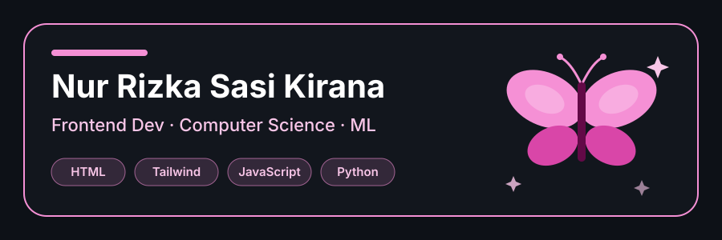

<h1 align="center">Hey 🦋 I'm Sasi</h1>

  

<!--
  OPSIONAL: taruh gambar/GIF aesthetic pilihanmu di folder assets/,
  lalu hapus tanda komentar di bawah ini.

  

-->

## About Me

  🎓 Computer Science Student &nbsp;·&nbsp; 💻 Frontend Developer &nbsp;·&nbsp;  
  📍 Jakarta, Indonesia &nbsp;·&nbsp;  
  💌 Let's connect and build something cool! 🎀

## Tech Stack

  
  
  
  
   
  
  
  
  

## Featured Project

<h2 align="center">✦ Featured Project</h2>

<table>
  <tr>
    <td>
      <h3>
        <a href="https://github.com/eshrecap/portfolio-tailwind-css">
          ♡ Portfolio Website
        </a>
      </h3>
      

        Personal portfolio website built with Tailwind CSS.
        A project showcasing my work, skills, and creativity.
      

      

        <strong>Tech Stack:</strong>
        HTML · CSS · Tailwind CSS
      

      

        <a href="https://github.com/eshrecap/portfolio-tailwind-css">
          ↗ View Repository
        </a>
      

    </td>
  </tr>
</table>

## Connect With Me

  
  
  

<!-- Contribution snake (dibuat otomatis oleh GitHub Actions) -->

  <picture>
    <source media="(prefers-color-scheme: dark)" srcset="https://raw.githubusercontent.com/eshrecap/eshrecap/output/github-snake-dark.svg" />
    <source media="(prefers-color-scheme: light)" srcset="https://raw.githubusercontent.com/eshrecap/eshrecap/output/github-snake.svg" />
    
  </picture>

  

<i>Let's connect!</i> 🌸

